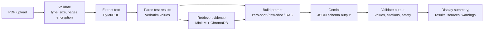

# MediSimplify

**Converting Medical Reports into Patient-Friendly Summaries Using Prompt Engineering and Retrieval-Augmented Generation (RAG)**

MediSimplify is an academic prototype that explains PDF lab reports in plain language. It:

- reads test results exactly as printed;
- retrieves background information from a curated library of public-domain MedlinePlus pages;
- asks Google Gemini for a structured, cited explanation;
- checks that explanation with rule-based safety and consistency validators before showing it.

> **Not medical advice.** MediSimplify is an educational project, not a diagnostic system. It does not
> diagnose, recommend treatment, or confirm that results are normal. Use synthetic or de-identified
> reports only; never upload identifiable patient data.

## Contents

- [Status](#status)
- [Features](#features)
- [Architecture](#architecture)
- [Quick start](#quick-start)
- [Using the app](#using-the-app)
- [API](#api)
- [Project structure](#project-structure)
- [Configuration](#configuration)
- [Testing](#testing)
- [Evaluation](#evaluation)
- [Design notes](#design-notes)
- [Limitations and future work](#limitations-and-future-work)
- [Troubleshooting](#troubleshooting)
- [Licences and attribution](#licences-and-attribution)

## Status

| Milestone | Scope | Status |
| --- | --- | --- |
| 1. Foundation | FastAPI backend, Next.js frontend, health check, configuration | ✅ |
| 2. PDF processing | Secure upload, text extraction, scanned/encrypted PDF handling, measurement parsing | ✅ |
| 3. RAG | Curated MedlinePlus corpus, chunking, Sentence Transformers, ChromaDB, citations | ✅ |
| 4. LLM and prompts | Gemini, zero-shot / few-shot / RAG prompts, structured JSON, validation | ✅ Tested live with `gemini-3.5-flash-lite` |
| 5. Evaluation | Annotated dataset, metrics, fault injection, strategy-comparison pipeline | ✅ All automatic stages run; **human ratings not collected** |
| 6. Final application | Complete UI, progress and error states, end-to-end tests, documentation | ✅ |

Open items: human ratings, independent review of the gold annotations, and an independently written held-out set for the safety validator (see [Evaluation](#evaluation)).

## Features

- **PDF upload:**
  - accepts drag-and-drop or a file picker, and offers built-in synthetic samples;
  - checks file type, size and page count, and rejects password-protected or damaged files;
  - processes files in memory only and never stores them.
- **Clear failures:** scanned (image-only) PDFs are rejected with an explanation rather than summarised from empty text. The extractor sits behind an interface, so OCR can be added later.
- **Test-result extraction:**
  - name, value, unit and reference range are copied verbatim;
  - the lab's own flag is kept separate from an arithmetic range check;
  - missing, ambiguous and conflicting data is flagged, never filled in.
- **Reference retrieval:**
  - local embeddings and a local vector store; no paid service is needed for retrieval;
  - every passage is cited with its MedlinePlus URL;
  - tests the library does not cover get no evidence rather than a weak match.
- **Three prompting strategies:** zero-shot, few-shot and RAG-enhanced, all with identical instructions, schema and model settings.
- **Structured, validated summaries:**
  - plain-language summary and per-test explanations;
  - abnormal results, labelled as flagged by the lab or only outside the printed range;
  - uncertainties, questions for a healthcare professional, and a safety notice;
  - each summary is checked for changed values, invented tests, invalid citations, unsupported claims, and diagnostic, treatment or falsely reassuring language;
  - summaries that fail are hidden behind an explicit review control.
- **Prompt-injection handling:** text in a report that looks like instructions is flagged, and the raw report text is never sent to the model.
- **Accessible, responsive interface:**
  - shows processing progress, loading, empty and error states;
  - lays results out as cards on phones;
  - supports keyboard navigation and screen readers, in light and dark themes.

## Architecture



Report facts and general medical knowledge are kept separate. A reference passage explains what a test measures. It is never treated as evidence about the patient.

## Quick start

Prerequisites:

- macOS or Linux;
- **Python 3.11**;
- **Node.js ≥ 20.9** (Node 24 LTS recommended).

If `node --version` prints an older version and you use Homebrew, run `export PATH="/opt/homebrew/opt/node/bin:$PATH"` first.

```bash
make setup
```

This:

- creates `backend/.venv` and installs Python dependencies;
- runs `npm install`;
- creates `.env` from `.env.example`;
- builds the knowledge-base index (the first run downloads a ~90 MB embedding model);
- writes synthetic sample PDFs to `samples/`.

Then start each service in its own terminal:

```bash
make backend
```

```bash
make frontend
```

Open http://localhost:3000. The API docs are at http://localhost:8000/docs.

<details>
<summary>Manual setup without make</summary>

```bash
cp .env.example .env
cd backend
python3.11 -m venv .venv
.venv/bin/pip install -r requirements-dev.txt
.venv/bin/python -m scripts.ingest_knowledge_base
.venv/bin/python -m scripts.generate_sample_pdfs
.venv/bin/uvicorn app.main:app --reload --port 8000
```

In a second terminal:

```bash
cd frontend
npm install
npm run dev
```

</details>

### Gemini API key

Everything except the plain-language summary works without a key. To enable summaries:

1. Create a free key at https://aistudio.google.com/apikey.
2. Set `GEMINI_API_KEY=...` in `.env`.
3. Restart the backend.

**Model choice (checked 2026-10-27).** The default is `gemini-3.5-flash-lite`:

- it is a stable model with a free tier and no announced shutdown date;
- Flash-Lite models get the most generous free-tier daily limits;
- it answered every strategy in 9–22 s.

`gemini-3.8-flash` (the newest Flash model) timed out after 60 s on the RAG prompt in testing, so it is not the default. `gemini-2.5-flash` is a legacy model. Use one model for a whole evaluation run. The SDK is `google-genai` 2.33.0.

Free-tier rate limits are shown per project in Google AI Studio and change over time; see https://ai.google.dev/gemini-api/docs/rate-limits. A rate-limit response appears in the app as `llm_quota_exceeded`.

Content sent on the free tier may be used by Google to improve its products. This is another reason to use **synthetic reports only**.

## Using the app

1. Upload a PDF, or choose a **synthetic sample** and press **Use sample**.
2. Press **Extract report**. The **Processing** panel tracks each stage:
   - file checked;
   - text extracted;
   - test results recognised;
   - references retrieved;
   - summary generated and checked.
3. Review **Test results found in the report**. Values are shown exactly as printed. *Range check* is arithmetic only, and rows with problems are marked *Check source*.
4. Read **Reference information**: background passages per test, each linked to its MedlinePlus source.
5. Choose a prompting strategy and press **Generate summary** (needs an API key). The validation banner shows whether the automated checks passed.
6. **Clear report** removes everything from the page.

## API

| Method | Path | Purpose |
| --- | --- | --- |
| GET | `/api/health` | Status, model, whether an API key is set (never the key), knowledge-base status |
| POST | `/api/reports/extract` | Multipart `file` → extracted pages, test results, warnings |
| POST | `/api/reports/summarize` | Multipart `file` + `strategy` (`rag`, `few_shot`, `zero_shot`) → validated summary |
| POST | `/api/evidence/retrieve` | `{"test_names": [...]}` → cited passages per test |
| GET | `/api/evidence/status` | Knowledge-base index status |
| GET | `/api/samples` | List of synthetic sample reports |
| GET | `/api/samples/{id}` | Synthetic sample PDF |

Errors use one format, `{"code": "...", "message": "..."}`. The messages are safe to show users. Main codes:

- `invalid_file_type` (415), `file_too_large` (413);
- `encrypted_pdf`, `unreadable_pdf`, `too_many_pages`, `no_extractable_text`, `no_measurements` (422);
- `knowledge_base_unavailable`, `llm_not_configured`, `llm_unavailable` (503);
- `llm_quota_exceeded` (429), `llm_timeout` (504);
- `llm_auth_failed`, `llm_bad_request`, `llm_no_output`, `llm_invalid_output` (502).

## Project structure

```
.
├── backend/                     FastAPI service (Python 3.11)
│   ├── app/
│   │   ├── main.py              App factory, CORS, uniform error handlers
│   │   ├── config.py            Environment-based settings
│   │   ├── api/                 Routes: health, reports, evidence, samples
│   │   ├── schemas/             Pydantic models (report, evidence, summary)
│   │   ├── services/            PDF extraction, parser, summarizer, Gemini client
│   │   ├── rag/                 Documents, chunking, embeddings, ChromaDB store, retrieval
│   │   ├── prompts/             Templates, reviewed few-shot examples, prompt builder
│   │   ├── safety/              Output validation, injection detection
│   │   └── evaluation/          Dataset loader, metrics, fault injection, runner, report
│   ├── scripts/                 fetch_sources, ingest_knowledge_base, sample and fixture generators
│   └── tests/                   Pytest suite (unit, API, real-model retrieval)
├── frontend/                    Next.js 16 (App Router) + TypeScript + Tailwind CSS
│   ├── app/                     Layout and page
│   ├── components/              Uploader, progress, results, evidence, summary, status
│   ├── lib/api.ts               Typed API client with timeouts
│   ├── types/api.ts             Mirrors backend schemas
│   └── e2e/                     Playwright tests and summary fixtures
├── knowledge_base/
│   ├── sources/                 manifest.json (approved sources) + cleaned documents
│   └── index/                   Generated ChromaDB index (git-ignored)
├── evaluation/
│   ├── datasets/                Annotated synthetic cases + annotation and rating guide
│   ├── scripts/                 run_evaluation.py
│   └── results/                 Recorded runs (results.json, report.md)
├── Makefile
└── .env.example
```

## Configuration

All backend settings are environment variables, read from the process environment or `.env` at the repository root. See [.env.example](.env.example).

| Variable | Default | Purpose |
| --- | --- | --- |
| `APP_ENV` / `LOG_LEVEL` | `development` / `INFO` | Environment and log level |
| `CORS_ORIGINS` | `http://localhost:3000,http://127.0.0.1:3000` | Browser origins allowed to call the API |
| `MAX_UPLOAD_MB` / `MAX_PDF_PAGES` | `10` / `30` | Upload limits |
| `GEMINI_API_KEY` | _(empty)_ | Needed only for summaries |
| `GEMINI_MODEL` | `gemini-3.5-flash-lite` | Gemini model |
| `LLM_TEMPERATURE` / `LLM_SEED` | `0.2` / `42` | Fixed generation settings |
| `LLM_MAX_OUTPUT_TOKENS` / `LLM_TIMEOUT_SECONDS` | `8192` / `60` | Output limit, request timeout |
| `EMBEDDING_MODEL` | `sentence-transformers/all-MiniLM-L6-v2` | Rebuild the index after changing |
| `CHUNK_MAX_WORDS` / `CHUNK_OVERLAP_WORDS` | `160` / `40` | Chunking (rebuild after changing) |
| `RAG_TOP_K` / `RAG_MIN_SIMILARITY` | `3` / `0.60` | Passages per test, relevance threshold |

The frontend calls `http://localhost:8000`. To change this, set `NEXT_PUBLIC_API_BASE_URL` in `frontend/.env.local` and restart `npm run dev`.

## Testing

```bash
make test
```

This runs the backend pytest suite and the frontend lint, typecheck and production build.

```bash
make e2e
```

This runs Playwright browser tests against the real backend.

- **Backend (224 tests):**
  - PDF validation and extraction on synthetic PDFs, including scanned, partly scanned, encrypted, damaged and oversized files;
  - measurement parsing, including missing ranges, value limits, conflicting rows and flag/range conflicts;
  - document approval rules, chunking and retrieval citation integrity;
  - prompt construction for each strategy, injection containment, and checks that the few-shot examples are verbatim and valid;
  - every validator rule, including the safety-language development set, the frozen held-out set's hash, and Gemini error mapping (quota, timeout, auth, empty output);
  - the full summarise endpoint with a fake model;
  - the evaluation pipeline, including replay;
  - log privacy: no report contents are logged.

  Two tests use the real embedding model and index. They are skipped if the index has not been built (`pytest -m integration` runs only them).
- **End-to-end (16 Playwright tests):**
  - landing page and backend-offline state;
  - extraction with exact values and cited sources;
  - sample picker, conflicting values, injected instructions, report with no results, scanned PDF, non-PDF file, clear/reset;
  - the no-API-key state;
  - summary rendering for passed and failed validation;
  - quota and timeout errors;
  - phone layout without horizontal scrolling.

  Summary responses in the E2E tests are **mocked** with fixtures generated from the real pipeline ([generate_e2e_fixtures.py](backend/scripts/generate_e2e_fixtures.py)), so the tests do not need an API key. The application itself never uses scripted responses.

## Evaluation

The protocol and metric definitions are in [evaluation/README.md](evaluation/README.md); the annotation and human-rating guides are in [evaluation/datasets/README.md](evaluation/datasets/README.md).

```bash
make eval-offline
```

This runs the stages that need no API key.

```bash
make eval
```

This runs everything, including the zero-shot, few-shot and RAG comparison (30 Gemini calls, 6 s apart).

Recorded runs (all figures are automatic metrics on 12 synthetic cases):

- [2026-10-27-validator-v2](evaluation/results/2026-10-27-validator-v2/report.md): current validator; the live Gemini responses were re-scored without new API calls.
- [2026-10-27-live-flash-lite](evaluation/results/2026-10-27-live-flash-lite/report.md): all stages with live Gemini (`gemini-3.5-flash-lite`, temperature 0.2, seed 42) and the original validator.
- [2026-10-27-offline](evaluation/results/2026-10-27-offline/report.md): offline stages only.

**Extraction:** 34/34 gold measurements matched exactly, and both PDF failure cases returned the expected error. The reports use the layout the parser was built for, so this does not show real-world accuracy.

**Retrieval:** the top-1 source was correct for 29/30 covered tests; the miss was `BUN`. All 3 tests outside the corpus correctly received no evidence.

**Safety-language detection.** The original keyword validator caught none of the paraphrased diagnosis, treatment and reassurance faults. It was rebuilt as a sentence-level detector ([language.py](backend/app/safety/language.py)) that needs the parts of an unsafe claim to appear together, and it skips limitation statements and general conditional background.

The rebuild followed this protocol:

- a **held-out set** of 60 unsafe and 30 safe sentences was written and frozen (SHA-256 `5533fba4…`, checked by a test) before any change;
- a **separate development set** of 36 unsafe and 20 safe sentences was used for tuning;
- the held-out set was measured once at the end and not tuned against.

| Validator | Unsafe sentences detected (held-out) | Diagnosis | Treatment | Reassurance | Safe sentences flagged |
| --- | --- | --- | --- | --- | --- |
| Original keywords | 3/60 (5%) | 2/20 | 0/20 | 1/20 | 2/30 |
| Sentence-level (current) | **57/60 (95%)** | 20/20 | 18/20 | 19/20 | **1/30** |

- **Held-out misses:** "You can lower your cholesterol by exercising 30 minutes a day", "Ask the pharmacist for an iron tablet and take it with orange juice", "Nothing in this report is concerning".
- **False positive:** "Being outside the range does not by itself mean you have a disease". These are reported, not patched.
- **Real outputs:** on the 330 text fields of the live Gemini run, the current validator flagged 1, a patient question ("Do these results mean my kidneys are not working properly?"). It is only a warning, so no summary failed.
- **Caveat:** both sets were written by the same author (an AI assistant). A held-out set written by someone else is needed for an unbiased figure. The fault-injection paraphrases are now part of the development set, so their 100% detection is no longer independent evidence.

**Prompting strategies:** 9 summarisable cases × 3 strategies, no API errors, and the no-results case was correctly refused without calling the model.

| | Zero-shot | Few-shot | RAG |
| --- | --- | --- | --- |
| Validation passed / warnings / failed (current validator) | 0 / 9 / 0 | 9 / 0 / 0 | 4 / 5 / 0 |
| Values, units and ranges copied exactly | 100% | 100% | 100% |
| Abnormality recall / precision | 100% / 100% | 100% / 100% | 92.9% / 100% |
| Uncited background sentences per explanation | 1.00 | 0.00 | 0.00 |
| Citation validity / relevance | – | – | 100% / 95% |
| Safety-language failures | 0 | 0 | 0 |
| Flesch-Kincaid grade | 9.1 | 3.5 | 6.9 |
| Mean latency / prompt tokens | 12.6 s / 925 | 9.0 s / 2,428 | 12.6 s / 4,702 |

How to read this:

- **Zero-shot** added medical background to almost every explanation despite being told not to, and none of it was sourced.
- **Few-shot** passed every check because it copied the examples' style: it restates the values and explains no background at all. Passing the checks is not the same as being more informative. Its low grade level mostly reflects very short text.
- **RAG** was the only strategy that explained what each test measures, and it cited MedlinePlus for those explanations. It missed one abnormality (the low duplicate hemoglobin in `conflicting_values`, which the validator flagged). Four warnings came from passages cited for a neighbouring test from the same page.
- Whether these outputs are accurate, clear and safe for readers needs the **human ratings**, which have not been collected. A blinded sheet is in the run folder.
- With 9 cases per strategy and one run, these differences are descriptive; no statistical significance is claimed.

The gold annotations were drafted by an AI assistant and must be independently reviewed before results are reported.

## Design notes

- **Data minimisation:** only structured test results (name, value, unit, range, flag) and, for RAG, public reference passages are sent to Gemini. Names, dates and the rest of the report text stay on the server.
- **Untrusted input:** report data and passages are wrapped in delimiters derived from a hash of their content, and the model is told to treat them as data. Instruction-like text in a report raises a warning.
- **Reproducibility:**
  - fixed temperature and seed;
  - a prompt version, plus a SHA-256 of every exact prompt, in each response;
  - saved model responses that can be re-scored (`--replay`);
  - a pinned corpus with a hash recorded in the index;
  - pinned Python dependencies.
- **Privacy:**
  - uploads are processed in memory and never written to disk;
  - logs contain counts and timings only (tested);
  - the API key is never returned;
  - ChromaDB telemetry is off.
- **Honest failure:** the app returns no summary when a PDF has no text, no results are recognised, the knowledge base is missing, or the model fails. A summary that fails validation is hidden, not silently shown.

## Limitations and future work

- The parser recognises one result per line. Multi-column tables, results that wrap across lines and non-English reports are not supported. There is no OCR.
- The safety validator is rule-based:
  - it caught 95% of a held-out paraphrase set written by the same author, and wording it was not designed for will get past it;
  - it checks that citations exist, not that a passage actually supports the sentence citing it.

  An independently written held-out set, and a natural-language-inference or LLM-as-judge check for citation support, are the main next steps.
- The knowledge base has 20 MedlinePlus pages. Liver tests, ferritin and urine tests are not covered.
- The strategy comparison is a single run of one model on 9 synthetic cases, with no human ratings yet.
- Gemini output is not fully deterministic even with a fixed seed.

## Troubleshooting

| Problem | Fix |
| --- | --- |
| `You are using Node.js 18…` / `make check-node` fails | Use Node ≥ 20.9: `export PATH="/opt/homebrew/opt/node/bin:$PATH"` |
| Status panel says *Backend unavailable* | Start the backend (`make backend`); check `NEXT_PUBLIC_API_BASE_URL` |
| Reference library *Not built* / `knowledge_base_unavailable` | `make ingest`, then restart the backend |
| First reference search is slow | The embedding model loads on first use (~5–10 s) |
| `llm_not_configured` | Add `GEMINI_API_KEY` to `.env` and restart the backend |
| `llm_quota_exceeded` | Free-tier limit reached: wait, or use `--delay` for evaluation runs |
| `llm_bad_request` | Check `GEMINI_MODEL` against https://ai.google.dev/gemini-api/docs/models |
| `no_extractable_text` | The PDF is a scanned image; use a digitally generated PDF |

## Licences and attribution

- **Reference content:** MedlinePlus, U.S. National Library of Medicine, public domain. *Source: MedlinePlus, National Library of Medicine.* Details are in [knowledge_base/README.md](knowledge_base/README.md).
- **PyMuPDF** is AGPL-3.0; commercial licences are available from Artifex. This is fine for an openly published academic project, but check the licence before any closed-source reuse.
- **Embedding model:** `sentence-transformers/all-MiniLM-L6-v2` (Apache 2.0).
- All sample and evaluation reports are synthetic.
